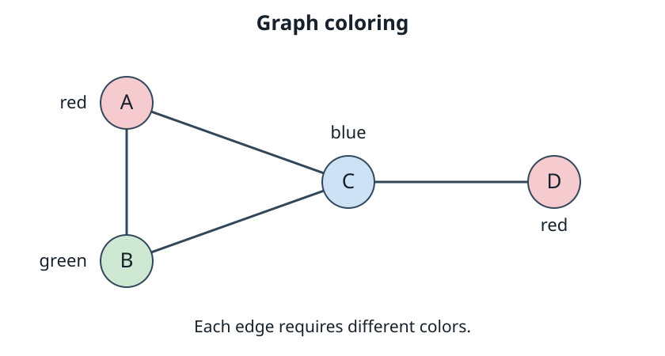
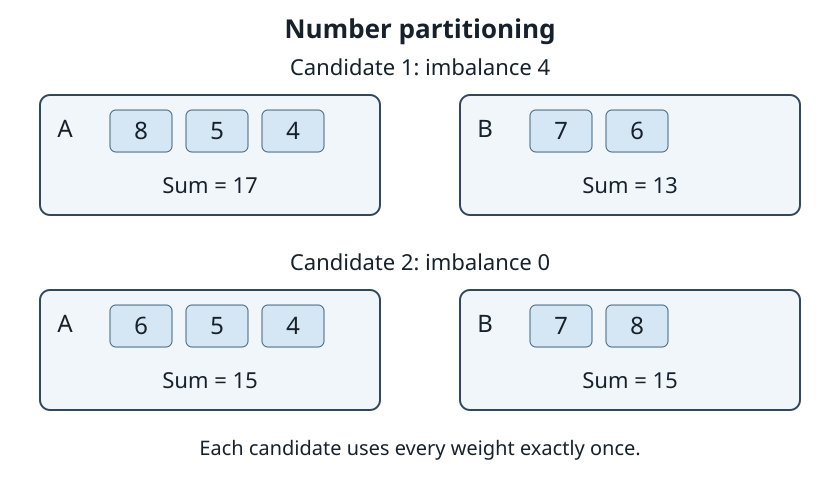
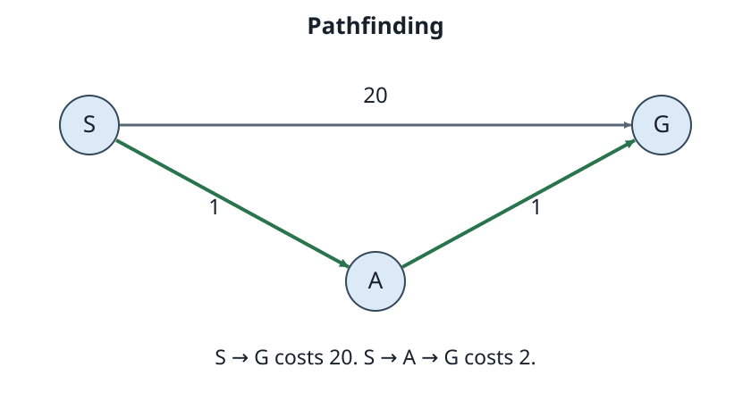
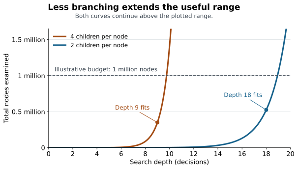
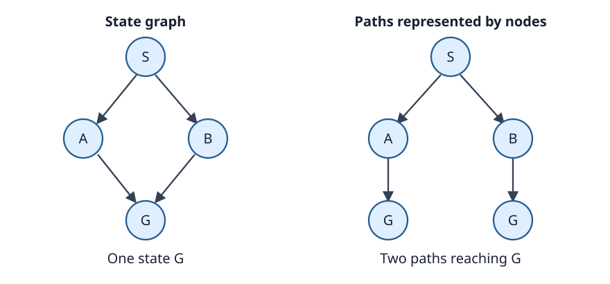

# Week 1: Models, States, and Problems

A state-space search explores possible answers to a problem.
The answer might be a consistent assignment of values, a
low-cost schedule, a balanced division of work, or a route
through a network. We can often describe the possibilities
and check a proposed answer quite directly. The difficulty
is finding a useful answer among all those possibilities.

This course treats state-space search as a technique for
solving tractable instances of NP-hard problems. We will
make the complexity terminology precise below. The practical
starting point is that a problem can be hard in general
while many particular instances remain solvable. A search
method succeeds by exploiting their structure: discovering
forced choices, excluding impossible combinations, estimating
what remains achievable, and concentrating computation where
it helps.

## Exploring possibilities

Suppose a timetable must place classes in rooms and time
slots. Trying every complete timetable and then checking
for clashes is a search method, but an expensive one. If two
classes already occupy the same room at the same time, we
can reject that partial timetable before placing the other
classes. One observation can eliminate many complete
candidates at once.

Alternatively, begin with a complete timetable that has
clashes and repeatedly move a class to reduce them. This
also explores a state space, but retains different
information. Constructing partial assignments can support
an exhaustive account of the possibilities. Repairing a
complete candidate may find an answer quickly while leaving
many alternatives unexplored. The task, representation,
and exploration policy together determine what we can
conclude from the result.

The central resource is computation. We must decide which
possibilities to generate, what to examine next, what to
remember, and what can safely be discarded. Examining a
promising candidate first changes search order. Establishing
that a whole group of candidates cannot contain a useful
answer justifies removing that group. These choices can
have very different effects on both performance and
correctness.

Three small examples will give these ideas concrete forms.
We will return to them throughout the book.

### Graph coloring: finding a feasible assignment

Map coloring gives a familiar motivation: neighboring
regions must have different colors. Represent each region
by a vertex and each shared border by an edge. The resulting
**graph coloring** problem assigns colors to vertices so
that each edge has differently colored endpoints. We will
use this graph representation throughout the book.

Take four vertices A, B, C, and D, with edges AB, AC, BC,
and CD, and allow red, green, or blue. A **constraint** states
a requirement on permitted combinations of choices; here
each edge requires different endpoint colors. A **feasible**
assignment satisfies every constraint.

*This graph coloring is feasible. A and D may share red
because there is no edge between them.*

An **assignment** gives colors to vertices; a **partial
assignment** leaves some vertices uncolored.

Start with no colors assigned. Choosing A=red and B=red
already violates AB. No choice for C or D can repair that
violation while those two assignments remain fixed, so we
can abandon all completions of that partial assignment.
Choosing A=red, B=green, C=blue, D=red instead gives a
complete feasible answer.

We need the final assignment; the order in which the solver
assigned the colors is usually irrelevant to its validity.
That order still matters to the effort needed to find it.
Starting with strongly interacting vertices may expose
conflicts earlier than assigning isolated vertices first.

### Number partitioning: improving a complete candidate

Divide weights 8, 7, 6, 5, and 4 into two groups. Minimize
an **objective**, the absolute difference between their
sums. The partition A={8,5,4}, B={7,6} is a complete
candidate with sums 17 and 13, giving objective value 4.
The partition A={6,5,4}, B={7,8} has sums 15 and 15,
giving value zero. Because an absolute difference cannot be
negative, the second candidate is optimal.

*The objective in number partitioning measures the difference
between group sums. Both pictured partitions are feasible.*

Here every division of the items is feasible. A more
constrained version could limit each group's capacity or
require specified items to stay together. We would then
seek a good objective value among the divisions satisfying
those restrictions. Scheduling similarly combines
feasibility requirements with objectives such as finishing
all work as early as possible.

A solver might construct partitions item by item or modify
complete partitions. Either way, the objective evaluates
the partition it returns. The sequence of exploratory
changes need not be part of that answer.

### Pathfinding: finding a route

In **pathfinding**, an answer is a path through a network.
Suppose S has a direct road to G costing 20, and another
route S→A→G with each road costing 1. Reaching G supplies a
route, but the direct road is more expensive than the
route through A. If we minimize travel cost, the desired
answer includes the sequence of roads and its total cost.
Merely reporting the final location G loses the answer.

*The two-edge path S→A→G costs 2; the one-edge path S→G
costs 20. Fewest edges and lowest cost are different goals.*

These tasks ask for different objects: an assignment, a
partition, and a path. Each has possibilities to explore,
a representation of those possibilities, and a way to judge
answers. We should choose a search method only after
identifying those features.

## Models, states, and instances

A **model** specifies the choices, restrictions, and outcomes
relevant to a task. For graph coloring, it names vertices,
available colors, and edges. For number partitioning, it lists
weights and defines the imbalance. For scheduling, it may
specify task durations, machines, and precedence rules.

A **state** represents one possibility in the search. It
might be a partial coloring, a complete partition, or a
location and remaining fuel. A **state space** contains the
states admitted by the representation. A rule for generating
other states defines how we can explore that space.

The state space depends on the solver's design. A
constructive coloring search can start with an empty
assignment and generate children by assigning the next
vertex. A repair search can start with every vertex colored
and generate neighbors by recoloring one vertex. The repair
space includes assignments violating the constraints: those
are candidates to improve, and cannot yet be returned as
feasible answers. A model's feasibility requirements and
the search's allowed intermediate states serve different
purposes.

For action-sequence problems, a familiar model specifies an
initial state, applicable actions, their resulting states,
and a goal test. It may also assign transition costs.
This describes a route planner or a sliding-tile puzzle
naturally. In an assignment search, a transition may instead
mean making an additional decision. It need not describe
an action to perform in the world.

Models deliberately simplify. A schedule may ignore setup
time between tasks. If setup time affects feasibility or
completion time, a solver can correctly optimize its model
and still return a poor real schedule. The first question
about an implementation is whether it explores the intended
possibilities and judges answers by the intended rules.

### Problems, instances, and classes

A **problem** describes a task with parameters that can
vary. Graph coloring specifies what to find, while leaving
the graph and available colors to be supplied. An
**instance** fixes those parameters: for example, our graph
with edges AB, AC, BC, CD and its three allowed colors.
Changing the graph or color choices gives another instance.

Think of the problem as the collection of allowed
instantiations of its parameters. This includes instances
with feasible answers and instances without them. In number
partitioning, the weights are parameters; our five weights
specify one instance of that problem. A search run tackles
one instance, not the entire collection at once.

A **complexity class** groups problems according to their
computational resource requirements. P and NP, introduced
below, are examples. Keep the levels separate: an instance
supplies particular data; a problem collects instances of
one task; a class collects problems with a stated
computational property. An algorithms textbook provides
the fuller formal treatment of these ideas.

## Growth and the practical limit

Return to graph coloring. If n is the number of vertices
and k is the number of available colors, there are kⁿ
complete assignments before applying edge constraints. Our
four-vertex, three-color instance has 3⁴=81 assignments.
With twenty vertices there are 3²⁰=3,486,784,401. A compact
instance can describe billions of possible answers.

A constructive search makes this growth visible as a tree.
Each node in this picture represents a record for a candidate
considered by the solver, such as a partial graph coloring. Its
children represent the next choices to consider. Counting
the nodes counts work on those candidates; the solver need
not construct or store the whole tree.

If each node has exactly b children, the total number of
nodes through depth d, counting the root at depth zero, is

**1 + b + b² + … + bᵈ = (b^(d+1) − 1)/(b − 1), for b>1.**

In a fixed-order coloring search, depth d means that d
vertices have been assigned. Each unconstrained choice has
three children. The leaves count complete assignments;
internal nodes count partial assignments examined along
the way. Pruning a partial assignment can remove an entire
subtree of completions.

Consider the simpler binary tree, with b=2. At an
illustrative constant rate of one million nodes per second,
exhausting the tree takes approximately:

| Depth | Total nodes examined | Time |
| ---: | ---: | ---: |
| 20 | 2,097,151 | 2.1 seconds |
| 30 | 2,147,483,647 | 35.8 minutes |
| 40 | 2,199,023,255,551 | 25.5 days |

Ten more binary decisions multiply the work by about 1,024.
At first several extra decisions seem inexpensive. Near a
fixed time or memory budget, a few more decisions make the
instance impractical. This is the sharp knee we often
experience when increasing instance size in a search solver.
The underlying work can grow smoothly while crossing a
practical limit abruptly.

*Reducing branching extends the useful depth. Both examples
still reach the same fixed resource limit. The curves are
mathematical illustrations, not measured solver results.*

The figure models successful pruning by reducing a uniform
branching factor from four to two. Below a budget of one
million nodes, the four-child tree reaches depth 9 and the
two-child tree reaches depth 18. That is a substantial gain.
Further growth still exceeds the budget in both cases.
Real pruning is irregular and instance-dependent; these
curves are not a prediction of its effect on every problem.

Faster hardware also moves the boundary. For work growing
roughly as 2^d, a millionfold speedup buys about twenty
additional levels at the same time budget. The improvement
is valuable, but each further twenty levels demand another
factor of roughly a million. Memory, expensive state
operations, and uneven branching can impose earlier limits.

Depth measures decisions in the chosen search representation.
It need not equal the chosen measure of instance size. In
graph coloring with a fixed vertex order, each decision
colors one more vertex. Other representations can change
branching, depth, and the work done per node.

### NP-hard families and solvable instances

Why focus on NP-hard problems? They capture the central
challenge of seeking practical solutions to problems for
which efficient general methods are not known. Complexity
theory studies resources as a function of instance size.
Before discussing difficulty in terms of n, always define
what n measures. It might count graph vertices, variables,
items, or bits in an input representation. A statement
about growth in n is incomplete until that choice is clear.

**P** consists of decision problems solvable in polynomial
time. A decision problem asks a yes-or-no question, such as
whether a graph can be colored with three colors.
**NP** consists of decision problems for which a yes answer
can be supported by a polynomial-length certificate checked
in polynomial time. A proposed graph coloring is a
certificate: check that each vertex has an allowed color
and every edge has differently
colored endpoints. Being in NP describes verification;
it does not by itself imply hardness.

A polynomial-time **reduction** translates instances of one
decision problem into another while preserving yes-answers
and no-answers. An **NP-complete** problem belongs to NP and
every problem in NP reduces to it in this sense.
An **NP-hard** problem is at least as hard as all problems
in NP under the relevant reduction; it need not itself
belong to NP or be a decision problem. For optimization,
we can often establish hardness through a decision question
about achieving a specified objective threshold.

If any NP-complete problem has a polynomial-time algorithm,
then P=NP. Whether that equality holds remains open.
NP-hardness therefore does not constitute a proof that
every algorithm must take exponential time. Nor does a
count of kⁿ candidates prove that every solver must examine
them all. The significance is that we cannot count on a
known efficient general algorithm, so exploiting structure
in the instances becomes essential to practical work.

An instance may have constraints that nearly force its
answer, repeated subproblems we can reuse, or bounds that
exclude most candidates. Another instance of the same size
may provide little such help. Unsatisfiable instances can
be difficult because the search must justify ruling out
every possibility. Proving optimality can require much
more work than finding a good candidate.

A practical solver's limit depends on this structure as
well as size. There is no universal vertex count or variable
count at which a problem family becomes intractable.
We want methods that solve useful instances and experiments
that reveal where those methods succeed and fail.

## Solution quality and search effort

The word "cost" can refer to different quantities. We will
keep three meanings separate:

| Quantity | Examples | What it measures |
| --- | --- | --- |
| Objective value | Partition imbalance, schedule length | Quality of a candidate |
| Path cost | Sum of road travel costs | Quality of a route or action sequence |
| Search effort | Nodes examined, seconds, peak memory | Resources used by the solver |

Path cost is one possible objective. In pathfinding,
the two-edge path costs 2 regardless of how many other
routes the solver investigated first. In number partitioning,
imbalance zero is optimal regardless of how many item moves
or partial assignments led the solver to discover it.
Charging one unit per exploratory move would define a
different optimization problem.

A node count is a machine-independent measure of search
work under a specified counting rule. For a fixed algorithm
and ordering, changing processor speed changes elapsed time
without changing the number of candidates it considers.
This makes counts useful for comparing search policies and
understanding growth beyond one particular machine.

The usual analysis assumes polynomial-time work per node
in the chosen instance-size measure n. If N nodes are
examined and all work charged to each node is bounded by
a polynomial p(n), total time is O(N·p(n)). This must include
generating successors and evaluating estimates; an expensive
inner search cannot be hidden inside a cheap node operation.

Search effort depends on both how much work is selected and
how much each operation costs. Two solvers can examine the
same number of nodes while taking different amounts of
time because one copies large states or computes a more
expensive estimate. A method examining fewer nodes can
still be slower. Node counts help explain behavior; time
and memory determine whether a run fits its resource budget.

We must also say what is counted. A **generated** node has
been produced as a candidate for consideration. An
**expanded** node has had its successors considered.
A solver might generate many duplicates and expand only a
few of them. Reporting both counts can expose work hidden
by a single headline number. [Week 8](08-engineering.md)
returns to representation and measurement in detail.

## States, records, and paths

The solver operates on records: it creates a candidate,
checks it, retains information about it, and generates
further candidates from it. We call such a record a
**node**. A node can contain a state, a link to the record
that produced it, and other information the algorithm needs.
The tree draws the relationships between these records;
visiting a node means processing its record. A **path**
records a sequence of transitions. Several nodes can
represent the same state.

Suppose an assignment search permits choosing variables in
either order. Assigning A=red then B=green reaches the same
partial assignment as assigning B=green then A=red. The
search tree can have two nodes for that assignment. A
fixed variable order can avoid this particular duplication.
For a route example, S→A→G and S→B→G likewise produce two
nodes for the state "at G."

*One state can occur along several exploration paths.
Whether the path is part of the answer depends on the task.*

The **state graph** has states as vertices and transitions
as directed edges. The **search tree** unfolds the paths
considered from a starting state. A graph can merge repeated
states even when the tree retains separate occurrences.
Revisiting A through A→B→A produces arbitrarily long paths
in a graph containing only two states. Local search
can cycle between candidates just as route exploration
can cycle between locations.

A state must retain the information relevant to future
choices and evaluation. For constructive coloring, the
partial assignment determines which choices remain legal.
For route finding with limited fuel, location alone is
insufficient: "at Pine with 12 liters" and "at Pine with
one liter" can have different reachable destinations.
If a rule prohibits revisiting rooms, the visited-room set
must also be represented.

This sufficiency of the present state is related to the
**Markov property**: relevant future transitions can be
determined without consulting an omitted part of the past.
Including additional history may enlarge the state space
substantially. Omitting necessary history changes the
problem that the solver actually explores.

Repeated states can sometimes be merged safely. For finding
one feasible coloring, two arrivals at the same partial
assignment represent the same remaining possibilities.
For minimum-cost routing, a cheaper arrival at a state can
dominate a more expensive arrival when their possible
continuations are identical. Keeping only an expensive
arrival can lose an optimal answer. Enumerating every path
would require a different policy again.

Removing artificial distinctions can help too. If exchanging
the names of two identical machines preserves feasibility
and objective value, a normalized representation may avoid
exploring both versions. Such a reduction requires an
argument that the information removed does not matter.
State equality, duplicate handling, and the desired answer
must be considered together.

## Generating a space without storing it

An **explicit graph** stores its vertices and edges directly.
Search often uses an **implicit graph**: represent a state
and generate its successors only when needed. In graph
coloring, generate extensions of the current assignment.
In number partitioning, generate other partitions by
transferring an item between groups. In pathfinding,
generate the locations reachable by one outgoing edge.

This avoids first listing an enormous space, but places a
correctness obligation on the generator. Missing choices
can hide an answer, and illegal choices can produce an
invalid result. A restricted move set can also disconnect
the search space, making some candidates unreachable from
the chosen start.

Some spaces are finite, such as all assignments to a fixed
finite set of finite-domain variables. Others are infinite,
such as states containing an unbounded counter. Even a
finite graph can unfold into an infinite tree of paths
when repeated states are not controlled. Finiteness of the
model and termination of a particular search procedure are
separate questions.

## Answers and guarantees

A feasible answer establishes that the modeled requirements
can be satisfied. An optimal answer additionally has the
best objective value among feasible answers. Finding a
coloring, proving that none exists, and finding a coloring
with the fewest colors require different evidence.

A method is **complete** if it eventually finds a solution
whenever one exists, under its stated assumptions. We must
ask separately whether it terminates with failure when no
solution exists. A method returning an optimal answer needs
a justification that a better answer has not been missed.
A disappointing candidate, or a long run without success,
provides no such justification by itself.

For minimization, an **incumbent** is the best feasible
complete candidate found so far. Its objective value U is
an upper bound on the optimum C*: C*≤U. A justified lower
bound L establishes L≤C*. Together they give

**L ≤ C* ≤ U.**

In number partitioning, the partition with imbalance 4
supplies U=4. Nonnegativity
supplies L=0. Finding the balanced partition makes U=0,
proving optimality because the bounds meet. A constraint
optimization solver can return a useful feasible answer
while still working to close this gap. A candidate violating
the hard constraints supplies no feasible upper bound.

Guarantees belong to algorithms under explicit assumptions.
An exploration can miss an existing answer by following an
infinite branch or by discarding useful repeated arrivals.
Path-search guarantees also depend on transition costs and
goal-test timing. We will develop those details with the
algorithms in [Weeks 3](03-systematic.md) and
[4](04-best-first.md); the
[notation reference](notation.md) collects their conventions.

## From models to algorithms

Before selecting a search method, identify the answer you
want, the states you will represent, the choices connecting
them, and the resources available for exploring them.
Then ask what structure the model exposes. Can a constraint
rule out a partial assignment? Can a bound show that a branch
cannot improve the incumbent? Can an inexpensive change
improve a complete candidate?

The next chapter develops constraints as a language for
expressing restrictions and deriving their consequences.
Systematic exploration, heuristic guidance, and candidate
repair will give us different ways to use that structure.
Their practical value is how far they extend the range of
instances we can solve, together with the evidence they
provide about the answers returned.

## Further reading

- Russell and Norvig, [*Artificial Intelligence: A Modern
  Approach*](https://aima.cs.berkeley.edu/), 4th US edition
  (2020), chapters 3 and 4. A longer treatment of problem
  formulation, path search, and local optimization. The
  course book supplies the necessary basics.
- Karp, [“Reducibility Among Combinatorial Problems”](https://doi.org/10.1007/978-1-4684-2001-2_9)
  (1972). The reduction framework behind NP-completeness;
  an extension for readers who want the formal theory.
- Khemani, [*Search Methods in Artificial Intelligence*](https://www.cambridge.org/core/books/search-methods-in-artificial-intelligence/contents/D2DE03267943183B66EF635E65048691)
  (2024), particularly its search-space coverage. The
  publisher TOC informed this book's topic selection;
  access to the book is not required for this course text.
