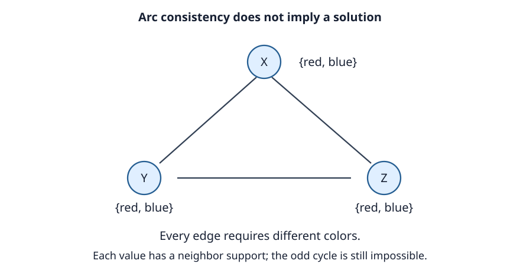

# Week 2: Constraints and Propagation

Many problems ask for a combination of choices satisfying
rules. A timetable assigns times while avoiding clashes. A
map-coloring task assigns colors while giving neighboring
regions different colors. A configuration tool selects
compatible components. These tasks can be modeled without
first specifying a sequence of actions.

A **constraint satisfaction problem**, or CSP, consists of
variables, domains, and constraints. Variables name choices.
A domain lists the values a variable may take. A constraint
specifies permitted combinations. A solution is a complete
assignment satisfying every constraint. This chapter considers
finite sets of variables with finite domains.

## Variables, domains, and constraints

Let X₁, …, Xₙ be variables with domains D(X₁), …, D(Xₙ).
A constraint on a group of variables is a relation over their
domains: it identifies allowed tuples. A unary constraint
concerns one variable, a binary constraint a pair, and a
higher-arity constraint three or more variables.

Suppose regions X, Y, and Z can be red, green, or blue. Each
has the domain {red, green, blue}. If X and Y share a border,
X ≠ Y expresses their constraint. The model states what is
valid; a solver chooses how to find an assignment.

A **partial assignment** gives values to some variables.
It is locally consistent if it violates no constraint whose
variables have all been assigned. This is a deliberately weak
condition: it does not say that the assignment can be extended
to a full solution. A solver may establish a stronger
contradiction by inspecting unassigned variables' domains.

A **current domain** contains values still considered possible
under the current branch and its propagation. It can be smaller
than the original domain. An empty current domain establishes
that the branch cannot lead to a solution. When backtracking,
the solver must restore values removed only because of choices
that have now been undone.

For binary CSPs, the **constraint graph** has one vertex per
variable and an edge between variables sharing a constraint.
For four regions A, B, C, D, take edges AB, AC, BC, CD.
The assignment A=red, B=green, C=blue, D=red satisfies every
edge inequality. Giving both A and B red violates AB.

This graph exposes interactions between choices. Choosing C
can affect A, B, and D; choosing D directly affects only C.
The pattern matters to both assignment order and propagation.
Density alone does not determine difficulty: the actual
relations and domain sizes matter too.

Some constraints are naturally global. An all-different
constraint requires every variable in a collection to have a
distinct value. It can be represented by pairwise inequalities,
but a dedicated propagator may extract more information.
If three variables must choose different values from {1,2},
no assignment exists. Each pair by itself still has support.
Equivalent solution sets do not imply equivalent propagation
strength or runtime.

## A small SAT encoding

Boolean satisfiability, or **SAT**, asks for truth values making
a formula true. A literal is a Boolean variable or its negation.
A clause is a disjunction of literals. In conjunctive normal
form, or CNF, all clauses must hold. Here ∨ means "or,"
∧ means "and," and ¬ means "not."

For a two-color triangle A, B, C, use Boolean variables rA,
rB, rC. A true value means red; false means blue. Adjacent
vertices U and V must differ. This becomes two clauses:

**(rU ∨ rV) ∧ (¬rU ∨ ¬rV).**

The first rules out both blue, and the second rules out both
red. For edges AB, BC, CA, the entire formula has three
variables and six clauses:

| Edge | Clauses |
| --- | --- |
| AB | (rA ∨ rB), (¬rA ∨ ¬rB) |
| BC | (rB ∨ rC), (¬rB ∨ ¬rC) |
| CA | (rC ∨ rA), (¬rC ∨ ¬rA) |

The assignment rA=true, rB=false, rC=true satisfies the first
two edges but violates CA. In fact no satisfying assignment
exists. Choosing A red forces B blue, which forces C red,
contradicting CA. Choosing A blue gives the symmetric failure.
The formula and the two-coloring problem have exactly the same
solutions: in this instance, none.

With k colors, a common encoding uses a Boolean variable
p(v,c) for every vertex v and color c. For each vertex, require
at least one p(v,c) to be true and at most one to be true.
For every edge uv and color c, add ¬p(u,c) ∨ ¬p(v,c).
The at-most-one condition can use one clause for every pair
of colors. Other encodings use auxiliary variables to avoid
some of this quadratic growth.

A model-to-SAT translation needs two directions of reasoning.
Every intended solution must extend to a satisfying assignment,
and every satisfying assignment must decode to an intended
solution. Missing a constraint can admit invalid candidates;
an unintended extra condition can exclude valid ones.

SAT is an NP-complete decision problem. Its practical success
on many structured instances is consistent with that
worst-case classification. It also illustrates a useful
engineering choice: encode a problem in a standard language
and use an existing solver, or build a specialized search
that exploits the original representation directly.

## Backtracking search

A straightforward CSP solver chooses an unassigned variable,
tries a value, and continues recursively. If a choice violates
a constraint or propagation finds an empty domain, it rejects
that branch. If every value for the selected variable fails,
it returns to an earlier choice. This is **backtracking**.

With n variables and at most k values per domain, there are
at most kⁿ complete assignments. For 20 variables with four
values, 4²⁰ = 1,099,511,627,776. Backtracking gains power by
rejecting partial assignments before completing them. If the
first two choices already violate a constraint, extending them
through the remaining eighteen variables serves no purpose.

For finite domains, backtracking is complete if it eventually
tries every relevant value, restores the branch state
correctly, and prunes only branches with no solution. Ordering
heuristics change which branches are reached first. Sound
propagation can remove branches that need never be reached.
These are distinct contributions.

A failed branch must leave no residue in its siblings. Suppose
A=red caused red to be removed from B's domain. When undoing
A=red, the solver must restore that removal unless another
still-active reason excludes red. Copying domains for each
branch makes this conceptually simple. Recording removals on
a reversible trail can make it cheaper. Either way, restoration
is part of the algorithm's correctness.

## Choosing variables and values

**Minimum remaining values**, or MRV, chooses an unassigned
variable with the smallest current domain. This is a
fail-first rule: make a difficult choice before spending time
on easy choices that might later have to be undone. A domain
of size zero already establishes failure. A domain of size
one may force consequences without genuine branching.

**Degree ordering** can break MRV ties by choosing the variable
with the most unassigned neighbors. In our four-region example,
C interacts with A, B, and D. Committing to it can reveal more
consequences than committing to D. The count of neighbors is
only a rough signal; relations differ in restrictiveness.

**Least-constraining value**, or LCV, orders the selected
variable's values by their impact on remaining domains.
Suppose A borders B and C, with domains B={red,green} and
C={blue,green}. Choosing A red removes one neighbor value;
choosing A blue also removes one; choosing green removes two.
LCV prefers red or blue to green in this local calculation.

LCV is a value-ordering rule; MRV is a variable-ordering rule.
Their intuitions fit together: confront the tightest variable,
then try to preserve flexibility in the remaining variables.
Computing an exact impact can itself be expensive. A solver
may estimate it or collect information during propagation.
There is no universal runtime improvement from an ordering
rule; its overhead and its effect on the particular instances
must both be measured.

## Forward checking

After assigning a variable, **forward checking** removes values
in neighboring unassigned variables that conflict with the new
assignment. If a domain empties, backtrack immediately.

Return to the graph with edges AB, AC, BC, CD and three colors.
Assigning A=red removes red from B and C. D is unaffected
because AD is not an edge. Assigning B=green then removes
green from C, leaving C={blue}.

| Stage | B domain | C domain | D domain |
| --- | --- | --- | --- |
| Initially | red, green, blue | red, green, blue | red, green, blue |
| A=red | green, blue | green, blue | red, green, blue |
| B=green | green (assigned) | blue | red, green, blue |
| C=blue | green (assigned) | blue (assigned) | red, green |

Choosing D=red or D=green now completes a valid coloring.
This trace separates assigning C from merely noticing that its
domain is a singleton. A solver can instead immediately assign
such forced variables, but that is an additional propagation
policy which should be stated.

Forward checking processes consequences of the newest
assignment on adjacent unassigned variables. It does not
repeatedly inspect relations among all remaining unassigned
variables. Those relations can already expose a contradiction
that forward checking has not detected. Arc consistency
provides a stronger local inference.

## Arc consistency and AC-3

For a binary constraint between X and Y, a value x in D(X)
has **support** in D(Y) if some y in D(Y) makes the pair
(x,y) satisfy that constraint. The directed arc X→Y is
**arc consistent** when every value of X has support in Y.
The reverse direction is a separate check, even when the
constraint is represented by one undirected graph edge.

Deleting an unsupported value is sound: no solution using the
current domains can include it, because such a solution would
also need a supporting neighbor value. When a domain shrinks,
other variables may lose their support in it. Repeating this
reasoning propagates information through the graph.

AC-3 keeps a queue of directed arcs. To revise X→Y, delete
values from X with no support in Y. If X becomes empty,
report branch failure. If X changes but remains nonempty,
queue Z→X for each other neighbor Z of X. The direction is
important: Z's values may have lost support in X. If nothing
changes, this revision creates no new work.

The usual rule excludes the just-checked neighbor Y when
adding arcs back to the queue, for a single binary relation
per pair with its transposed reverse relation. Removing an
X value that had no Y support cannot remove support for any
Y value. An implementation can queue extra arcs safely;
it just does unnecessary work. Duplicate queue entries may
also be suppressed without changing the fixed point.

Here is a complete trace. Let X, Y, Z each initially have
domain {1,2,3}, with constraints X<Y and Y<Z. Start a FIFO
queue with X→Y, Y→X, Y→Z, Z→Y. Treat an arc already queued
as present rather than adding another copy.

| Revision | Unsupported values removed | Domains after revision |
| --- | --- | --- |
| X→Y | X=3 | X={1,2}, Y={1,2,3}, Z={1,2,3} |
| Y→X | Y=1 | X={1,2}, Y={2,3}, Z={1,2,3} |
| Y→Z | Y=3 | X={1,2}, Y={2}, Z={1,2,3} |
| Z→Y | Z=1, Z=2 | X={1,2}, Y={2}, Z={3} |
| X→Y (requeued) | X=2 | X={1}, Y={2}, Z={3} |

The first revision removes X=3 because no Y is larger.
The reverse revision removes Y=1 because no X is smaller.
Checking Y<Z then removes Y=3. This reduction requeues X→Y:
X=2 has lost its only supporting Y value. Meanwhile Z must
exceed the sole remaining Y=2, forcing Z=3. The result is the
unique solution X=1, Y=2, Z=3, obtained without a guess.

For finite domains, every useful revision deletes a value,
and values are not added during one propagation phase.
There can be only finitely many deletions. The queue therefore
eventually empties or an empty domain establishes failure.
The final result is a fixed point for this inference rule.

## Local support and global solutions

A fixed point is not a proof that a solution exists. Consider
X, Y, Z with domain {red,blue} and constraints X≠Y, Y≠Z,
Z≠X. Each red value has blue support across every individual
edge, and each blue value has red support. No value is
removed. Yet the two-color triangle has no solution.

*Arc consistency checks each pair locally. The contradiction
requires considering the cycle as a whole.*

**Sound propagation** never deletes a value participating in
a solution within the current branch. A **complete decision
procedure** would determine satisfiability in every instance.
Arc consistency supplies sound local inference, but not a
complete CSP decision procedure. Backtracking supplies the
remaining choices: assign a value, propagate, and explore
other choices if that branch fails.

For example, assign X=red in the triangle. Propagation forces
both Y and Z blue. Their inequality then loses all support,
so the branch fails. Trying X=blue gives symmetric failure.
The combination of finite exhaustive branching and sound
propagation can establish unsatisfiability even though the
initial propagation phase cannot.

## Propagation in SAT and modern solvers

SAT has its own natural propagation rule. A clause is **unit**
when all but one of its literals are false and the remaining
literal is unassigned. That literal must be made true if the
clause is to hold. An all-false clause establishes a conflict.

For the formula (A∨B) ∧ (¬A∨C) ∧ ¬B, the last clause forces
B=false. The first clause then forces A=true; the second
forces C=true. All clauses hold. These consequences follow
from the formula rather than from a choice of search order.
On another formula, propagation might stop with some variables
unassigned and require a decision.

Modern SAT solvers combine decisions, propagation, and conflict
analysis. A conflict can justify a learned clause that prevents
repeating the same incompatible combination. It can also
justify returning past several decisions at once rather than
undoing only the most recent one. General constraint solvers
combine search with propagators specialized to different
constraint types.

We do not need the full machinery of an industrial solver to
see the underlying design. Search introduces assumptions;
propagation extracts consequences; conflicts show when those
assumptions cannot coexist. Correct learning retains only
consequences justified by the model and current reasoning.

The representation affects how much of this reasoning is
available cheaply. A compact model may hide useful structure;
a slightly larger model may expose strong propagation. We
should judge a model by correctness, inference strength, and
cost together. The next chapter develops the systematic
exploration that complements these inference rules.

## Further reading

- Mackworth, [“Consistency in Networks of Relations”](https://doi.org/10.1016/0004-3702(77)90007-8)
  (1977). The foundational account of local consistency and
  constraint-network algorithms; follow the support argument
  before studying more efficient variants.
- Dechter, [*Constraint Processing*](https://www.sciencedirect.com/book/9781558608900/constraint-processing)
  (2003). A broader reference on representations, inference,
  and search. Useful for extending the short treatment of
  global constraints and structural properties.
- Davis, Logemann, and Loveland,
  [“A Machine Program for Theorem-Proving”](https://doi.org/10.1145/368273.368557)
  (1962). An early systematic SAT procedure and a starting
  point for understanding the decision/propagation connection.
