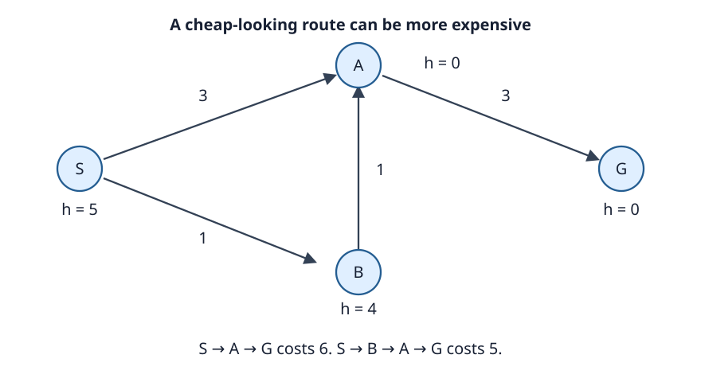

# Week 4: Best-First Search

Depth-first and breadth-first search choose work by a
structural rule. Best-first search instead assigns each
frontier entry a priority and removes one with minimum
priority. The score can represent cost already paid, estimated
cost still to come, or both. Those choices define different
algorithms with different guarantees.

We use g for a path's accumulated cost, h for an estimate of
remaining cost, and h* for the true cheapest remaining cost.
All edge costs are nonnegative. Heuristics are nonnegative
and zero at goals. An admissible heuristic satisfies h≤h*.
A consistent heuristic additionally satisfies
h(s)≤c(s,t)+h(t) on every edge s→t.

A queue entry represents a path to a state, not just the
state itself. Two entries for one state can have different
costs. Handling that difference correctly is as important
as selecting the priority formula.

## One queue, three priorities

| Method | Priority | What it favors |
| --- | --- | --- |
| Uniform-cost search | g | Cheapest discovered path prefix |
| Greedy best-first search | h | Smallest estimated remaining cost |
| A* | g+h | Smallest estimated total solution cost |

A tie-break rule selects among equal priorities. It affects
traces and performance. We specify ties where needed in a
worked example; the basic cost proofs permit any rule that
does not indefinitely postpone required work.

Uniform-cost search, abbreviated UCS, is the search
interpretation of Dijkstra's shortest-path algorithm.
A* reduces to UCS when h is zero everywhere. Greedy search
with h=0 instead makes all entries tie. It does not become
UCS unless some additional rule explicitly orders by g.

A priority is a selection rule. It is not automatically a
lower bound or a certificate. Greedy h omits the path cost.
Weighted priorities studied later can deliberately exceed a
valid completion-cost lower bound. Give each score a meaning
before using it in a proof.

## Arrivals, improvements, and stale entries

Keep a table best_g[s] recording the least cost discovered
for state s. A new path is worth enqueuing when its cost
strictly improves that record. Initialize best_g[start]=0;
other states have no known cost, conventionally infinity.

Many queues make insertion easier than changing the key of
an existing entry. A **lazy update** simply inserts the
improved path and leaves the old entry in the queue.
On removal, compare the stored cost with current best_g.
An outdated entry is **stale** and must be skipped.

```text
best_g[start] := 0
insert an entry for start with g=0 and its priority

while the queue is not empty:
    entry := remove a minimum-priority entry
    s := entry.state
    if entry.g != best_g[s]: continue
    if goal(s): return the path represented by entry

    for each edge s→t of cost c:
        candidate := entry.g + c
        if t has no recorded cost or candidate < best_g[t]:
            best_g[t] := candidate
            create a path entry for t, linked to entry
            insert it with the chosen priority
return failure
```

Each path entry here has an immutable parent-entry link.
Reconstruction therefore follows the exact route represented
by the selected entry. A compact implementation may instead
maintain state-based predecessor records, but it must ensure
that reconstruction and the reported cost remain consistent
when records change.

Strict improvement suppresses equal-cost duplicates,
including repeated travel around a zero-cost cycle.
The algorithm seeks one solution path. Enumerating all
optimal paths needs extra predecessor information and a
different treatment of ties.

This general loop has no permanent closed set. A state can
be expanded again after a strict cost improvement.
For UCS, a nonstale expansion already has optimal g, so
reopening is unnecessary under nonnegative costs.
For A*, that conclusion requires consistency; admissibility
alone does not provide it.

## Uniform-cost search

UCS chooses minimum g. Suppose S has a direct edge to goal G
costing 10, and an edge to A costing 1, followed by A→G
costing 1. Expanding S generates a goal, but that goal is
not yet a reason to stop.

The queue first contains A at cost 1 and G at cost 10.
Removing A discovers a better G entry at cost 2.
That entry is removed next and returns S→A→G.
The old cost-10 entry is stale if it is ever examined.

This example motivates accepting a goal on a nonstale
minimum removal, rather than on generation. Generating a
goal establishes a feasible upper bound. It does not
establish that all cheaper routes have been ruled out.

The optimality argument considers a supposedly cheaper
solution. Suppose UCS removes a goal costing C, while an
optimal route costs C*<C. Along that route, retain the first
prefix whose optimal-cost arrival has not yet been expanded.
Its predecessor's optimal arrival has already been expanded,
so this prefix, or an equally good arrival, remains eligible
in the queue. Its cost is at most C*. It must precede a
cost-C goal, contradicting the minimum-g selection.

This argument also explains why a Boolean visited flag on
generation is wrong for weighted paths. The first generated
route to G cost 10. Marking G permanently visited at that
moment would block the later improvement to 2.

On a finite graph, nonnegative costs and strict best-g
improvements give termination and an optimal answer whenever
a goal is reachable. If no goal is reachable, the finite
search is exhausted and reports failure.

On an infinite graph, a useful sufficient condition is finite
branching, a finite-cost solution, and a fixed positive lower
bound ε on every edge cost. A path costing at most C then
has depth at most C/ε. Only finitely many paths can precede
the goal's cost contour.

Merely positive costs are insufficient. Costs can shrink
along an infinite path so their sum stays below a goal's cost.
Zero-cost edges can likewise create infinitely many distinct
cost-zero states. An infinite low-cost region can delay the
goal forever.

Negative edges invalidate UCS's finalization argument.
A route expanded at cost 5 might later be improved through
an as-yet-unseen negative edge. Negative cycles can make a
finite minimum undefined. Such models need other algorithms.

For an explicit graph with adjacency lists, a binary heap
with one active record per vertex gives the familiar
O((|V|+|E|) log |V|) bound. A lazy queue can hold O(|E|)
records and has a corresponding logarithmic queue cost.
The distinction matters for multigraphs and actual memory
accounting. In implicit problems, exponentially many states
may fit below the optimal cost contour.

## Greedy best-first search

Greedy best-first search chooses minimum h, ignoring g.
It asks which state appears closest to a goal, regardless
of the expense of getting there.

Consider S→A costing 8 and A→G costing 1, versus S→B
costing 1 and B→G costing 4. Set h(A)=0, h(B)=3, and
h(G)=0. Greedy chooses A, then the goal it generates,
returning cost 9. The alternative costs 5.

Both estimates are admissible: A has true remaining cost 1,
and B has true remaining cost 4. Even setting h(S)=0 makes
this example consistent. Neither property makes greedy
search cost-optimal; its priority omits accumulated cost.

A finite graph can be searched completely with adequate
duplicate control. An infinite graph can defeat greedy
search even with finite branching and positive costs:
an infinite sequence of attractive estimates can keep
outranking a reachable goal elsewhere.

Greedy search is useful when early feasibility matters and
the estimate effectively guides the tested problem family.
A returned route is a valid answer to reachability.
Its path cost has no general approximation guarantee.
Calling the estimate admissible does not change that fact.

This distinction is easy to lose because UCS, greedy search,
and A* can share almost all their implementation machinery.
Changing one priority formula changes the mathematical
reason the first removed goal should be accepted.

## A* and admissible lower bounds

A* chooses minimum f=g+h. Since h is admissible,
g+h lower-bounds the cost of every completion of this
particular path. A* combines the price already paid with
an optimistic estimate of what remains.

Let C* be the optimal solution cost. While an optimal route
has not been completed, a correctly maintained frontier
contains an eligible prefix of an optimal route with its
optimal prefix cost. For that prefix, g+h≤C*.

Now suppose A* removes a suboptimal goal costing C>C*.
Its priority is C because h(goal)=0. The optimal prefix
has a strictly smaller priority, contradicting minimum-f
selection. Thus the removed goal is optimal.

The frontier-prefix claim is the substance of the proof.
It can fail if the implementation throws away a useful
better arrival. A* with an admissible heuristic therefore
needs correct strict-g updates and, when necessary, reopening.
An algorithm name alone does not provide the guarantee.

On finite graphs, the loop above terminates under the stated
nonnegative-cost assumptions. On infinite spaces, finite
branching and costs bounded below by ε>0 again provide a
useful sufficient condition: nonnegative h makes g≤f,
so every entry with f≤C* has bounded depth.
Admissibility by itself does not ensure finite progress
through infinitely many cheap states.

A heuristic may underestimate by a large amount and remain
admissible. That can make A* explore almost as much as UCS.
An overestimate can focus work well in practice but removes
this optimality proof. [Week 10](10-frontiers.md) gives a
controlled way to trade solution quality for search order.

## Consistency and reopening

Consistency supplies a relation between neighbors:

**h(s) ≤ c(s,t)+h(t).**

Adding g(s) shows that f cannot decrease along a path:
g(s)+h(s)≤g(s)+c(s,t)+h(t).
With consistent h, a state's first nonstale A* expansion has
its least possible path cost. A permanent closed set can
therefore finalize it.

Consistency also implies admissibility for states with a
finite route to a goal, when goal estimates are zero.
Apply the inequality repeatedly along any such route;
the intermediate h terms cancel and leave h(s) no greater
than that route's cost. Taking a cheapest route gives h≤h*.

The converse is false. An admissible heuristic can make
an estimate drop abruptly across a cheap edge.
A* can then expand a state through an expensive route before
discovering a cheaper one.

[](figures/reopening.svg)

In this original example, the true remaining costs are
5 at S, 4 at B, 3 at A, and 0 at G.
The displayed heuristic is admissible. It is inconsistent
on B→A because 4 is greater than 1+0.

| Removed entry | Work performed |
| --- | --- |
| S, g=0, f=5 | Insert A at g=3,f=3 and B at g=1,f=5 |
| A, g=3, f=3 | Insert G at g=6,f=6 |
| B, g=1, f=5 | Improve A to g=2,f=2 |
| A, g=2, f=2 | Improve G to g=5,f=5 |
| G, g=5, f=5 | Return S→B→A→G, cost 5 |

A must be expanded twice. A version that permanently closes
A after its first expansion can instead return cost 6.
The strict-improvement loop permits the reopening naturally:
the new A record is eligible even though an older A record
was expanded.

The stale cost-6 goal is harmless because the current
cost-5 goal is removed first. More generally, skip stale
records before using them for expansion or termination.
Queue membership alone does not establish that a stored
path still represents the best discovered arrival.

## Heuristic strength and practical cost

Suppose h₂(s)≥h₁(s) everywhere and both are admissible.
Then h₂ is said to dominate h₁. It supplies at least as
tight a lower bound at every state. Maximum combination
can produce such improvements without double-counting.

This does not mean a stronger heuristic is automatically
faster. Computing it may cost more. Ties on the optimal
f contour, inconsistent estimates and repeated expansions,
preprocessing, and table lookups all affect actual work.
Measure runtime as well as node counts.

Nor does heuristic guidance eliminate A*'s frontier storage.
Keys, path entries, best-g records, queue slack, and stale
entries can grow large. An excellent estimate may make a
particular instance easy while another instance still
exhausts memory.

[Week 5](05-heuristics.md) explains how to construct lower
bounds by relaxation and abstraction, combine estimates
safely, and trade repeated work for reduced retained memory.
The common basis is the meaning of g+h as a bound.
The algorithms differ in how much of the frontier they
keep available.

## Further reading

- Dijkstra, [“A Note on Two Problems in Connexion with
  Graphs”](https://doi.org/10.1007/BF01386390) (1959).
  The shortest-path method underlying UCS.
- Hart, Nilsson, and Raphael,
  [“A Formal Basis for the Heuristic Determination of
  Minimum Cost Paths”](https://doi.org/10.1109/TSSC.1968.300136)
  (1968). The foundational formal treatment of A*.
- Dechter and Pearl,
  [“Generalized Best-First Search Strategies and the
  Optimality of A*”](https://doi.org/10.1145/3828.3830)
  (1985). Develops the conditions behind stronger claims
  about best-first search and efficiency.
