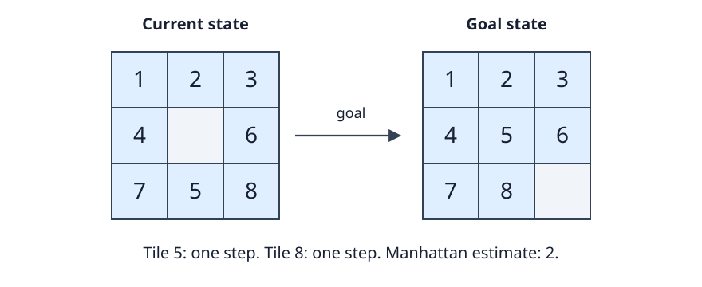

# Week 5: Heuristics and Limited Memory

[Week 4](04-best-first.md) established why A* uses g+h:
accumulated cost plus an admissible estimate lower-bounds
the cost of completing a path. We now ask where useful
estimates come from and what to do when the frontier does
not fit in memory.

A heuristic h is admissible when 0≤h(s)≤h*(s), where h*
is the true cheapest remaining cost. At goals h=0.
A zero heuristic is admissible but supplies little guidance.
The design task is to obtain a stronger lower bound without
spending more time or memory than the resulting search saves.

## Relaxing the problem

A **relaxation** makes the problem easier in a controlled way.
Every original solution must remain a permitted relaxed
solution, with no greater cost. The relaxed optimum then
cannot exceed the original optimum.

If h_R(s) is the exact relaxed optimum from s, it follows
that h_R(s)≤h*(s). This is an admissibility argument.
The relaxed problem may have physically impossible plans;
that is acceptable because their costs are used as optimistic
bounds, not returned as executable answers.

The word “exact” matters. Finding one relaxed solution
provides an upper bound on the relaxed optimum. That value
need not lower-bound the original optimum. An approximation
to the relaxed optimum requires its own lower-bound argument
before it can safely guide optimal A* pruning.

For a sliding-tile puzzle, a legal unit-cost action moves
one numbered tile into the adjacent blank. Ignore interference
between numbered tiles and ask how many grid steps each tile
needs to reach its goal cell. A tile at row r and column c,
with goal row r_g and column c_g, needs at least

**|r−r_g| + |c−c_g|**

moves of that tile. Summing these distances for the numbered
tiles gives **Manhattan distance**. Do not include the blank.

The sum is admissible because each legal action moves exactly
one numbered tile by one grid step. A real solution must pay
for every tile's required displacement. Tiles blocking one
another can add moves, but cannot remove that necessary work.

[](figures/manhattan.svg)

Here only tiles 5 and 8 are displaced. Move 5 upward into
the blank, then 8 leftward into the new blank. The estimate
2 equals the true solution cost in this instance.
Other configurations can require detours that the independent
tile calculation omits.

Manhattan distance is also consistent for this unit-cost
puzzle. One move changes the distance of only the moved
tile, by one. The estimate cannot drop by more than that
move's cost. This extra property supports the finalization
rule discussed in Week 4.

## Combining lower bounds

Suppose h₁ and h₂ are admissible for the same remaining-cost
objective. Their maximum is admissible:

**h_max(s)=max(h₁(s),h₂(s)).**

Each component is no larger than h*, so their maximum is
no larger either. Maximum combination uses whichever bound
is stronger at the current state.

Their sum is not automatically safe. If both components
count the same necessary move, adding them counts that move
twice. Two estimates of one can sum to two even when one
action reaches the goal. The estimates were individually
admissible; the combination is not.

Addition becomes safe through **cost partitioning**.
For every real action a, assign nonnegative component
costs c_i(a) such that their sum is no greater than c(a).
Each component problem must admit a projection of every
real solution with those assigned costs.

Take any real solution. Its projection in component i
costs at least that component's optimal value h_i.
Summing these values charges no more than the real path's
total cost, by the per-action condition. This is true for
every real solution, including an optimal one. Therefore
the sum of the h_i values remains admissible.

This is the same accounting principle used for scheduling
bounds in [Week 8](08-engineering.md). Different explanations
of necessary work may overlap. Their maximum is often safe;
their sum requires evidence that the costs do not overlap.

## Pattern databases

A **pattern database** stores exact remaining costs for
a simplified, abstract state space. At search time, map the
concrete state to its abstract state and look up the result.
The admissibility proof belongs to the abstraction: a
concrete solution must project to an abstract solution of
no greater cost.

In a tile puzzle, a pattern retains the positions of a
selected group of tiles and the information needed for
legal abstract moves, often including the blank. Other
tiles become indistinguishable background. A table can be
built by searching backward from abstract goals.

A larger pattern preserves more tile interactions. It can
give a stronger estimate while requiring much more storage
and preprocessing. State ranking maps each abstract
configuration to a table index; it must preserve the intended
identity, rather than accidentally merging different cases.

For additive databases, divide numbered tiles into disjoint
groups. Assign a real move's unit cost to the group containing
the tile moved. In every other group's abstract problem,
that move costs zero. Across all groups, one real move is
charged exactly once.

Compute each abstract shortest-path table using those costs
and add the lookups. Each real plan projects to every
component, and the summed charges do not exceed its cost.
Interactions among tiles within a group can make this
stronger than independent Manhattan distances.

Disjoint tile names alone are not sufficient. If several
tables each charge the full cost of a shared action, their
sum may overestimate. Explain the abstract transitions and
the cost assignment together.

Zero-cost abstract moves also affect construction.
Ordinary FIFO BFS is not generally a shortest-path algorithm
for mixed zero/one costs. Dijkstra or a suitable zero/one
queue procedure respects that cost model. Using the wrong
precomputation algorithm can corrupt the heuristic before
the main search begins.

The total memory budget must include these tables.
An algorithm with a tiny active search stack can still use
gigabytes of heuristic data. Report preprocessing time,
table size, lookup cost, and whether reuse across instances
justifies that investment.

## IDA*: iterative deepening on cost estimates

Iterative deepening A*, or **IDA***, replaces a retained
best-first frontier with a sequence of depth-first traversals.
Each traversal permits only paths whose f=g+h is no greater
than a threshold B.

Start with B=h(start). When a node exceeds the threshold,
record its f value and backtrack. After an unsuccessful
iteration, use the smallest exceeded f as the next threshold.
Do not simply add one: costs and estimates may be fractional,
irregular, or separated by large gaps.

```text
current_path := [start]
bound := h(start)
repeat:
    next_bound := infinity
    result := visit(start, g=0, bound, current_path)
    if result is a solution: return result
    if next_bound = infinity: return failure
    bound := next_bound

visit(state, g, bound, path):
    f := g + h(state)
    if f > bound:
        next_bound := min(next_bound, f)
        return failure
    if goal(state): return a copy of the current path
    for each successor not already on path:
        extend path, recurse with its cost, and restore path
        if recursion found a solution: return it
    return failure
```

The shared next_bound is reset once per iteration.
Test f before accepting a goal, so a goal outside the current
cost threshold cannot bypass the bound. Preserve a copy of
the successful path before restoring mutable path storage.

Consider S→A and S→B, each costing 1. A leads to goal G_A
with cost 5; B leads to G_B with cost 2.
Set h(S)=2, h(A)=5, h(B)=1, and h=0 at both goals.
The best real solution costs 3 through B.

With A tried first and bound 2, A has f=6 and is cut off.
B has f=2 and is expanded, but its goal has f=3 and is cut
off. The next threshold is min(6,3)=3.
The second iteration still rejects A and reaches G_B at cost
3. It does not waste passes at thresholds unrelated to an
observed boundary.

Why is this optimal? On an optimal route, every path prefix
has admissible f≤C*. If an iteration below C* fails, the
first excluded prefix on that route offers an exceeded
value no greater than C*. The next threshold therefore
need not jump above C*. Once a goal is accepted, its cost
equals its f and cannot exceed C*.

That argument also needs finite progress. With finite
branching, nonnegative h, and edge costs bounded below
by ε>0, a traversal under B reaches depth at most B/ε.
There are only finitely many paths inside the optimal
cost contour, so the thresholds cannot postpone a finite-cost
optimal goal through infinitely many smaller boundary values.

For a finite graph with path-local cycle checking,
nonnegative costs can suffice without a positive ε:
only finitely many simple paths exist. On an infinite
graph, zero costs or arbitrarily small positive costs can
defeat termination of one bounded traversal.

## What IDA* retains

A path-local cycle set rejects states already on the active
route. It permits the same state on other routes and in
later iterations. A global visited set carried between
iterations would suppress work made newly eligible by a
larger threshold. A transposition cache needs cost-, depth-,
and threshold-aware reasoning.

Let D be the greatest depth actually reached during the
run. With incrementally generated successors and constant-size
state records, IDA* can use O(D) search records.
Materializing all siblings at each level instead gives
O(bD). Neither figure includes pattern databases or optional
duplicate tables.

D need not equal the shallowest goal depth. Unequal costs
and depth-first ordering can send the traversal deeply into
a branch before it returns a shallower goal. Avoid calling
all depth-based memory bounds O(d) without saying which
depth d measures.

The memory saving comes from regeneration. Each threshold
starts over. A weak heuristic, irregular costs, or many
closely spaced boundary values can produce substantial
repeated work. IDA* is attractive when the frontier is the
limiting resource and lower bounds prune enough of the tree
to compensate for discarded history.

## Recursive best-first search

**Recursive best-first search**, or RBFS, retains more
information about nearby alternatives. It descends through
the best current child while remembering the best competitor
outside that branch. When the chosen branch becomes more
expensive than that competitor, it backs up a summary and
changes direction.

Each node has a backed-up value F. At the root,
F=h(start). Initialize a generated child's value as

**F(child)=max(F(parent), g(child)+h(child)).**

The maximum prevents estimates from decreasing along the
active path, even when h is inconsistent. The inherited value
is a lower bound already established for that branch's
possible completions.

At a node, sort children by F. Recurse into the best child
with a limit equal to the smaller of the inherited limit
and the second-best child's F. If the chosen branch later
exceeds that limit, the recursive call returns its revised
F. Store the summary and compare alternatives again.

```text
RBFS(node, limit):
    if node is a goal: return solution, F(node)
    generate children excluding active-path cycles
    initialize each child's F
    if no children exist: return failure, infinity
    repeat:
        choose best and second-best children by F
        if F(best) = infinity or F(best) > limit:
            return failure, F(best)
        alternative := F(second-best), or infinity if absent
        result, revised := RBFS(best, min(limit, alternative))
        F(best) := revised
        if result is a solution: return result, revised
```

The infinity test is necessary. When the best branch is
exhausted and the limit is also infinity, the comparison
infinity>infinity is false. Without the explicit exhaustion
case, an implementation can recurse repeatedly into work
already proved fruitless.

For a small example, suppose two children have F values
4 and 7, and the inherited limit is 10.
RBFS explores the first with limit 7. If that branch reports
a new bound of 9, the children now rank 7 and 9.
The other branch is explored with limit 9.
The algorithm remembers that the first branch costs at
least 9, rather than remembering all its descendants.

Stored sibling bounds make this more responsive than
restarting from the root at every global threshold.
They do not preserve the complete frontier. When an old
branch becomes best again, forgotten descendants must be
regenerated. Repeated switching can make total time much
larger than A*'s.

RBFS retains up to b child records at each of D active
levels, giving O(bD) search records under the stated
constant-record assumption. It is linear in depth when
branching is treated as bounded. Heuristic tables and large
concrete states remain additional costs.

With admissible estimates and appropriate finite-search
conditions, the backed-up bounds preserve the possibility
of an optimal route while alternatives are reordered.
As with IDA*, finite branching and a positive lower cost
bound provide useful conditions for finite progress in
potentially infinite spaces. Path-cycle checking avoids
cyclic active routes; it does not eliminate every repeated
state across different routes.

## Choosing what to remember

A* keeps a global frontier and avoids much regeneration.
IDA* keeps a path and repeats cost-bounded traversals.
RBFS keeps a path plus nearby sibling summaries, forgetting
detailed descendants when it backs out.

All three use the same lower-bound idea. Their different
memory policies decide how much previously discovered
structure remains immediately available. There is no
universal winner: heuristic strength, table storage,
duplicate frequency, successor cost, and available memory
all influence the practical tradeoff.

The next chapter changes strategy more substantially.
Local search keeps complete candidates and repairs them,
rather than retaining a systematic account of every
unexplored branch.

## Further reading

- Korf and Felner,
  [“Disjoint Pattern Database Heuristics”](https://doi.org/10.1016/S0004-3702(01)00092-3)
  (2002). Explains additive abstraction heuristics and
  the accounting needed to combine them safely.
- Korf, [“Depth-First Iterative-Deepening: An Optimal
  Admissible Tree Search”](https://doi.org/10.1016/0004-3702(85)90084-0)
  (1985). The foundational cost-bounded iterative-deepening
  result behind IDA*.
- Korf, [“Linear-Space Best-First Search”](https://doi.org/10.1016/0004-3702(93)90045-D)
  (1993). Develops RBFS and the tradeoff between retained
  bounds, memory, and regeneration.
