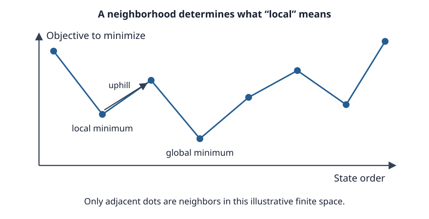

# Week 6: Local Search and Repair

A local-search algorithm keeps a complete candidate in view
and changes it a little at a time. It may improve a schedule,
repair a coloring, or shorten a tour without building a tree
of all partial solutions. The main questions are how to score
a candidate, what changes to allow, and how to escape a region
where the available changes no longer help.

The traversal methods in [Week 3](03-systematic.md) retain
information about unexplored alternatives. Local search
usually retains one candidate, or a small collection, and
forgets much of its earlier trajectory. This can make its
memory requirement modest even when the candidate space is
enormous. It also changes what the method can certify.

## Complete candidates and imperfect assignments

For a CSP, a local-search candidate ordinarily assigns a
value to every variable. "Complete" means that no variable is
unassigned, not that every constraint holds. A repair method
can move among inconsistent complete assignments until it
finds one satisfying all constraints.

A convenient objective is

**E(x) = number of constraints violated by candidate x.**

We minimize E. A zero score establishes a solution, provided
that every constraint is represented correctly. A positive
score supplies a direction for improvement but does not prove
that the original CSP is unsatisfiable.

For optimization, a candidate can already be feasible while
having a poor objective. A complete tour visits all cities;
local search can seek a shorter tour. This distinction matters
when returning an answer under a time limit. An infeasible
coloring with two conflicts is useful information about a
search trajectory, but is not a proper coloring.

Some applications combine hard feasibility requirements with
soft costs. A weighted penalty can guide repair, but an
arbitrary penalty weight does not ensure that every feasible
candidate outranks every infeasible one. A solver must either
justify the weights, compare feasibility and quality
lexicographically, or keep a separate record of the best
feasible candidate.

## Neighborhoods define the search

A **neighborhood** N(x) contains candidates reachable from x
by one permitted move. For graph coloring, a move might
recolor one vertex. For number partitioning, it might transfer
one item between groups. For a tour, it might reverse a
segment or replace two edges.

A candidate is a **local minimum** if no neighbor has a
strictly smaller objective. It is a **global minimum** if no
candidate anywhere has a smaller objective. A local minimum
is always relative to a neighborhood: a candidate can resist
one-item moves while admitting an improving two-item move.

A larger neighborhood can expose useful coordinated changes,
but costs more to inspect. A problem with n variables and k
values has at most n(k−1) single-variable changes from one
complete assignment. Examining all pairs of changed variables
can increase the candidate move count quadratically in n.
The larger reach must justify the extra evaluation cost.

The neighborhood also determines reachability. If moves can
never change a particular property, the search remains in one
component of the candidate graph. An apparently good escape
policy cannot reach a solution in another component. Check
that the allowed moves can connect the kinds of candidates
that the application needs to consider.

## A repair trace for graph coloring

Return to the graph coloring instance from Weeks 1 and 2:
vertices A, B, C, D and edges AB, AC, BC, CD, with three
available colors. Let E count conflicting edges: an edge is
in conflict when its endpoints share a color.

Start with every vertex red. All four edges conflict, so
E=4. A **min-conflicts** move selects a conflicted vertex
and gives it a color minimizing conflicts on its incident
edges, breaking ties by a stated rule or at random.

Select C, which is incident to AC, BC, and CD. Its neighbors
are all red. Recoloring it blue removes all three conflicts;
AB still conflicts. Next select A and recolor it green.
AB and AC now both have different endpoint colors, yielding
a proper coloring.

| Candidate | A | B | C | D | E |
| --- | --- | --- | --- | --- | ---: |
| Initial | red | red | red | red | 4 |
| Recolor C | red | red | blue | red | 1 |
| Recolor A | green | red | blue | red | 0 |

This trace demonstrates the repair mechanism, not a guarantee
that every start converges so quickly. A vertex's best color
can still leave conflicts. Recoloring one vertex can also
recreate a conflict that a previous move removed. Random
selection among conflicted vertices and tied colors can vary
the trajectory without altering the objective's meaning.

The min-conflicts rule focuses work on the damaged part of
the current candidate. It can be effective when a nearly
satisfying assignment has inexpensive local repairs. Strong
dependencies can instead make repairs interfere. There is no
queue of unexplored branches proving that all alternatives
will eventually be considered.

## SAT as local search

For the SAT formulas introduced in [Week 2](02-constraints.md),
a complete candidate gives every Boolean variable a truth
value. Let E count unsatisfied clauses. A move flips one
variable from true to false or from false to true. A score
of zero supplies a satisfying assignment.

For example, return to (p∨q)∧(¬p∨r)∧¬q. The assignment
p=false, q=false, r=false violates only p∨q, so E=1.
Flipping p makes that clause true but makes ¬p∨r false:
E remains 1. Flipping r next satisfies every clause,
giving E=0. The first move is sideways on this objective,
although it changes which clause is violated.

**WalkSAT** focuses on the violated part of a CNF formula.
It chooses an unsatisfied clause and flips a variable from
that clause. Flipping such a variable satisfies the selected
clause but can break other clauses. WalkSAT policies combine
preferences for flips that break few clauses with randomized
choices that help escape stalled regions. The precise
selection, tie-breaking, and noise rules define the variant.

This is a repair process over complete assignments, whereas
Week 2's backtracking extends and undoes partial assignments.
Both can find satisfying assignments. An unsuccessful
time-limited WalkSAT run does not establish unsatisfiability;
it has not accounted for all alternatives. Keep failures and
budgets visible when evaluating the method in Week 7.

## A checkable local minimum

For **number partitioning**, divide positive weights into two
groups to minimize the absolute difference between their sums.
Use weights 8, 7, 6, 5, 4 and the candidate

**A={8,5,4}, B={7,6}.**

The sums are 17 and 13, so E=4. With a neighborhood that
transfers exactly one item, the possible new scores are:

| Item transferred | New A sum | New B sum | Absolute difference |
| --- | ---: | ---: | ---: |
| 8 from A to B | 9 | 21 | 12 |
| 5 from A to B | 12 | 18 | 6 |
| 4 from A to B | 13 | 17 | 4 |
| 7 from B to A | 24 | 6 | 18 |
| 6 from B to A | 23 | 7 | 16 |

No transfer strictly improves E=4. This is a local minimum,
though not a strict one: transferring 4 preserves the score.
It is not globally optimal. Exchanging 8 in A with 6 in B
produces A={6,5,4}, B={7,8}, with both sums 15 and E=0.
That is one move in a swap neighborhood, but two transfers
in the original neighborhood.

A path of transfers reaches the optimum too: move 8 from A
to B, temporarily increasing E to 12, then move 6 back,
reaching zero. Strict descent rejects the first step. Thus
changing the move set and accepting occasional worsening
moves are two different ways to cross the same obstacle.

## Landscapes, plateaus, and barriers

A **landscape** associates each candidate with its objective
and connects neighboring candidates. The familiar picture
of hills and valleys is conceptual; the real graph can have
many dimensions and irregular connections.

*This is an illustrative finite space, not measured data.
Only adjacent dots are neighbors. The second dot has no
improving neighbor, although the fourth dot is lower.*

A **plateau** contains connected candidates of equal score.
Accepting only strict improvement can stop on the plateau's
edge even when sideways moves lead to an exit. Allowing
sideways moves can find that exit, but can also cycle. A
sideways-move budget or memory of recent moves can control
how long the search wanders.

A **barrier** requires an uphill intermediate step to reach
a lower region. The partitioning example gives a numerical
instance. A **ridge** informally describes a region where
useful coordinated progress is poorly aligned with the
available single moves. These names identify design problems;
they are not substitutes for specifying an actual graph,
objective, and move rule.

The landscape belongs to the objective and neighborhood
together. An improving compound move can remove a local
minimum that was present under smaller moves. Changing a
penalty function can also reshape the landscape, but can
change which candidates count as best. A solver must preserve
the intended task while changing its guidance.

## Evaluating a move incrementally

Evaluating every neighbor by rebuilding and scoring the whole
candidate can dominate runtime. A **delta evaluation** computes
only the objective terms changed by the move.

For an undirected simple coloring graph without self-loops,
let n_c(v) count neighbors of v currently colored c. Recolor
v from a to b. Before the change, its incident conflicting
edges number n_a(v); afterward they number n_b(v). Every
other edge is unchanged. Therefore

**ΔE = E(after) − E(before) = n_b(v) − n_a(v).**

In our all-red initial coloring, C has three red neighbors
and no blue neighbors. Recoloring C blue gives ΔE=0−3=−3,
so E changes from 4 to 1, agreeing with the full recount.
A negative delta is an improvement under our minimization
convention.

The formula counts conflicting edges, not conflicted
vertices. A vertex with three bad incident edges contributes
three to this edge objective. If instead each conflicted
vertex contributed one, recoloring C could also change the
status of its neighbors, and the formula would differ.
Derive the delta from the actual objective rather than
borrowing a formula for a similar-sounding score.

Keeping neighbor-color counts makes evaluating a proposed
color inexpensive. After accepting v's recoloring, update the
counts for its neighbors: one fewer neighbor of color a and
one more of color b. The accepted move still requires work
proportional to v's degree. Cheap proposal evaluation does
not mean that every operation is constant time.

For partitioning, keep the **signed difference** D=sum(A)−sum(B).
Moving an item of weight w from A to B gives D′=D−2w;
moving it from B to A gives D′=D+2w. The objective afterward
is |D′|. The factor of two accounts for subtracting w from
one group and adding it to the other.

For the initial partition D=4, transferring weight 4 from
A gives D′=−4: the groups exchange which is heavier while
the objective stays 4. Keeping only the unsigned difference
without recording which group is heavier would make the
update ambiguous.

For a symmetric traveling-salesperson tour, a two-edge
exchange removes edges (a,b), (c,d), reconnects (a,c), (b,d),
and reverses the intervening segment. Its length delta is
c(a,c)+c(b,d)−c(a,b)−c(c,d). Symmetry is essential to that
short formula: reversing internal edges does not change their
cost. In an asymmetric tour, internal reversed edges can
change cost too and must be included.

Incremental state is valuable but creates bookkeeping
obligations. A mistaken update can cause later moves to be
scored against a fictional objective. During development,
compare deltas with full rescoring on small instances and
occasionally recompute the objective after accepted moves.
These checks test the representation as well as the search
policy.

## Escape policies and retained information

**Random restarts** discard a stalled candidate and draw a
new start. They can reach different basins of attraction
without storing a large frontier. Their effectiveness depends
on the starting distribution and the cost spent before each
restart. If every start quickly reaches the same basin,
restarts provide little diversity. [Week 7](07-stochastic.md)
derives their expected cost under explicit assumptions.

**Tabu search** retains short-term memory, often forbidding
recent move reversals or attributes of recent moves. This
can discourage short cycles while allowing a non-improving
move to leave a local minimum. The memory has a tenure:
a move eventually becomes available again. An aspiration
rule may override the restriction, for example when a move
would improve the best feasible solution ever seen.

A tabu list is not an exhaustive visited-state set. It may
store attributes rather than exact states and may forget
entries. Its purpose is to shape the trajectory. It neither
proves that no candidate has been missed nor automatically
prevents all cycles.

**Compound neighborhoods** permit coordinated changes,
such as the partitioning swap above. A solver need not
materialize every possible compound move. It can sample
moves, focus on conflicting variables, or search a restricted
neighborhood with a separate solver. The restriction must
be included in the method's description: examining a sample
of neighbors does not establish local optimality over the
whole neighborhood.

An implementation should distinguish the current candidate
from the **best-so-far** candidate. An escape policy may make
the current objective worse while preserving an earlier good
answer. If feasibility matters separately from penalties,
retain the best feasible answer explicitly. Under a deadline,
that is the candidate the solver can actually return.

## What a local search can establish

A proper coloring with E=0 proves that the modeled coloring
instance is satisfiable. A partition with difference zero
proves optimality because no difference can be negative.
A local minimum with positive score establishes neither
unsatisfiability nor global optimality.

Even the claim of local optimality requires care. It is
justified after every move in the stated neighborhood has
been ruled out as a strict improvement. A method that checked
only ten sampled moves and found none can report a stalled
sampled search, not a certified local optimum.

Local search is especially useful when complete candidates
can be scored cheaply and imperfect candidates still provide
guidance. Its strength comes from the interaction between
representation, move set, delta evaluation, and escape rule.
The next chapter introduces controlled randomness and explains
how to evaluate the resulting variation from run to run.

## Further reading

- Minton, Johnston, Philips, and Laird,
  [“Minimizing Conflicts: A Heuristic Repair Method for
  Constraint Satisfaction and Scheduling Problems”](https://doi.org/10.1016/0004-3702(92)90007-K)
  (1992). The central repair idea and its scheduling context.
- Glover, [“Tabu Search—Part I”](https://doi.org/10.1287/ijoc.1.3.190)
  (1989). A primary account of memory-based trajectory control.
- Selman, Kautz, and Cohen,
  [“Noise Strategies for Improving Local Search”](https://cdn.aaai.org/AAAI/1994/AAAI94-051.pdf)
  (AAAI-94, pp. 337–343). Develops randomized SAT repair
  strategies associated with WalkSAT, connecting clause
  violations, local choices, and escape from local minima.
- Korf, [“A Complete Anytime Algorithm for Number
  Partitioning”](https://web.cecs.pdx.edu/bart/cs510cs/papers/korf-ckk.pdf)
  (1998). A useful contrast: a heuristic partitioning idea
  extended into anytime search, retaining information
  needed to prove optimality.
