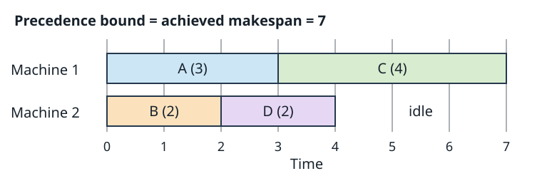

# Week 8: Engineering Search

Two implementations can expand the same search nodes and have
very different runtimes. Moving state data, comparing keys,
allocating records, and coordinating workers can dominate the
cost of the abstract algorithm. Search performance depends on
both how much work is selected and how much each unit costs.

This chapter connects the algorithms to the systems executing
them. We examine representation, memory, measurement, and
parallel work, then use planning and scheduling as compact
applications. The objective is to preserve the model and its
guarantees while making useful work cheaper.

## Representations and hot operations

An abstract state needs a concrete representation. A grid
puzzle might use a two-dimensional array, a flat array, or a
packed integer. Each supports the same configurations but has
different costs for copying, generating moves, comparing
states, and computing hashes.

Begin with the frequent operations. Does each expansion
create many children? Does heuristic evaluation inspect most
of the state? Does duplicate detection dominate? An efficient
representation makes those operations inexpensive while
remaining understandable enough to implement correctly.

A packed state of a few machine words can be cheap to copy
and compare. A flexible structure of separately allocated
objects can make changes easier to express, but add pointers,
allocation, and scattered memory accesses. Packing can also
make updates more complicated. The right comparison is the
cost of the whole repeated operation, not a general rule that
one data structure is always faster.

### Canonicalization and equality

A **canonical representation** maps equivalent situations to
one key. If exchanging the names of identical boxes changes
nothing about legal moves or cost, normalizing their order
can avoid artificial duplicates. This requires a symmetry
argument: the normalized states must preserve the relevant
future possibilities, costs, and goals.

If an answer must name particular objects, path reconstruction
may need to retain the correspondence between normalized
objects and concrete actions. A representation that correctly
recognizes feasibility but cannot reconstruct an executable
answer is incomplete as a solver design.

A hash function maps a key to an integer used to find table
locations. Different keys can have the same hash. Exact
duplicate detection compares actual keys after finding a
candidate entry; the hash alone is not proof of equality.
Storing only a fingerprint makes a different, probabilistic
correctness tradeoff and must be described that way.

Keys must also remain stable while stored. Mutating a key
after inserting it into a hash table can make the record
unreachable or corrupt equality assumptions. Use immutable
stored keys or an explicit remove/update/reinsert procedure.
Poorly distributed hashes can slow lookups even when collision
handling preserves correctness.

## Copying and reversible state

One simple successor operation copies the parent state and
applies a move to the copy. Parent and child are independent,
which makes correctness easy to inspect. If an expansion
creates b children and copying costs C, its copying work is
roughly bC before heuristic and queue costs.

For a small state, that can be an excellent bargain. For a
large state with small changes, persistent structures can
share unchanged parts, allocating only what changed. Sharing
reduces copying but introduces indirection, allocation, and
lifetime management. Following several pointers per lookup
can cost more than copying a compact record.

Depth-first search naturally permits another choice: mutate
a state, explore a child, and undo the mutation before trying
the next child. A **trail** records the values or domain
entries needed for restoration. Its memory can be proportional
to the active path rather than all generated candidates.

Every branch exit must undo exactly the changes it owns,
including exits caused by propagation failure, bounds, or
success. A missed restoration contaminates sibling branches.
It can create apparent solutions or remove real ones without
an obvious crash.

Best-first search retains many frontier states at once.
One mutable state cannot stand for all of them. A frontier
entry must store a state, share an immutable version, or
retain enough information to reconstruct it. Replaying paths
can save memory while increasing reconstruction time. These
choices implement different time–space tradeoffs around the
same abstract frontier.

### Bitsets, locality, and control flow

A bitset packs Boolean facts into machine words. Sixty-four
flags can fit in one 64-bit word. Membership, intersection,
and some domain operations can then use a small number of
word operations instead of visiting many separate objects.
Sparse sets may benefit more from compact lists or hybrid
representations; scanning all words is wasteful when almost
all bits are irrelevant.

Processors exploit **locality**: nearby or recently accessed
data is often available in cache. Nodes scattered over the
heap can require a chain of memory accesses. A contiguous
array can bring several useful fields into cache together.
Indices into such an array can also use fewer bytes than
full pointers, depending on the design and size limit.

Control flow matters too. A successor generator may execute
many tests whose outcomes vary unpredictably. A processor
can speculate incorrectly on those branches and discard work.
Grouping similar operations or using bulk bitset tests can
sometimes reduce this cost. It can also add unnecessary
work or obscure an efficient short-circuit test. Measure on
the actual workload rather than assuming that removing a
branch necessarily improves performance.

The same applies to vectorization and concurrency. Performing
many similar heuristic evaluations together can expose
parallel work, but batching can increase latency or compute
values for nodes later discarded. A hardware opportunity is
useful only when it improves the solver's end-to-end task.

## Account for memory explicitly

Search storage includes much more than one state. A best-first
solver may retain keys, path costs, parent records, a frontier,
a duplicate table with unused capacity, and temporary children.
A depth-first solver with a large global visited set is no
longer a small-memory search merely because its active stack
is short.

Consider an illustrative design with a 16-byte key, a 24-byte
record, and an average 16 bytes of hash-table storage and slack
per stored state. That is 56 bytes per state. For 500,000
states, it is 28,000,000 bytes, about 26.7 MiB.

Suppose another 300,000 frontier entries each take 24 bytes.
They add 7,200,000 bytes, about 6.9 MiB. The modeled total is
35,200,000 bytes, about 33.6 MiB.

| Component | Count | Bytes each | Total bytes |
| --- | ---: | ---: | ---: |
| State record, key, table share | 500,000 | 56 | 28,000,000 |
| Queue entry | 300,000 | 24 | 7,200,000 |
| Modeled total | | | 35,200,000 |

These numbers are assumptions, not a measured allocator
footprint. They exclude program data, alignment, temporary
allocations, and growth peaks during resizing. They also
assume no accidental double counting of shared keys. The
exercise of accounting is useful because a few extra bytes
per state become substantial at millions of states.

Measure peak resident memory along with time. A search that
is fast until it exhausts memory has not solved the intended
instance. If memory is the limit, reconsider what information
must remain live, the compactness of its representation, and
whether a memory-bounded algorithm is appropriate.

## Measure work and throughput

Expansion counts and wall-clock time answer different
questions. A baseline expanding one million nodes at 100,000
per second takes about ten seconds. A stronger heuristic
might reduce the count to 400,000 but lower throughput to
30,000 per second, taking about 13.3 seconds. Fewer expansions
need not mean less time.

Record generated and expanded nodes, duplicate detections,
frontier size, solution quality, runtime, and peak memory.
Profile successor generation, heuristic evaluation, hashing,
queue operations, and allocation where useful. Keep the
instance collection and stopping rule comparable.

A representation change should preserve the intended graph
and algorithm. Check returned solutions as well as rates.
An algorithm change may legitimately alter expansion order
and node counts. A report should identify which change was
made and whether it reduced work, lowered its unit cost, or
both. [Week 7](07-stochastic.md) supplies the additional
care needed when random variation affects these measurements.

## Parallel work and global guarantees

A search tree offers many branches, but those branches need
not require equal work. Splitting the first few subtrees
between workers can leave one worker with nearly all the hard
cases. **Work stealing** lets an idle worker request part of
another worker's unexplored work. The split must transfer
ownership clearly so no branch is silently lost.

Independent restarts are an easy parallel policy for stochastic
search. Workers use different random streams and retain their
best feasible answers. Combining their answers gives the best
result found by the deadline. This does not turn the collection
into a complete search or make the seeds independent samples
of different problem instances.

Parallel best-first search needs additional coordination.
A single shared priority queue preserves a global selection
order but can become a contention point. Local queues reduce
that contention while allowing a worker to expand a node that
another worker would rank below its current best choice.
Changed order can increase or decrease total work.

One approach assigns a state to a worker using a deterministic
hash. All discoveries of that state go to its owner, which
maintains its best path cost and duplicate records. This
avoids an unsynchronized global duplicate table. It adds
communication and can distribute work unevenly; a good hash
does not guarantee equal expansion costs or equally promising
queues.

Finding a goal does not immediately prove optimality. A
cheaper route may still be queued elsewhere, undergoing
expansion, or travelling in a message. An optimal termination
protocol must account for all such work. Likewise, every queue
being empty at one instant does not establish exhaustion if
messages can still generate work. A shared incumbent can help
workers prune, but the lower-bound and termination arguments
must cover the whole distributed search.

Reproducibility also changes. Even with fixed seeds, thread
scheduling may alter which incumbent arrives first and which
branches are subsequently pruned. Record the worker count,
coordination policy, and variability across repeated runs.
Measure speedup against a stated sequential baseline, including
communication and startup. More workers need not imply less
wall-clock time or less total computation.

## Planning as an implicit state graph

A simple deterministic planning language describes a state as
a set of Boolean facts. An action has preconditions, facts it
adds, and facts it deletes. It is applicable when its
preconditions hold. Applying it removes its delete effects and
then adds its add effects. Here the effect sets are disjoint.

Consider a courier at depot A, carrying a parcel. The goal is
to deliver it at B and return to A. The courier first needs a
key available at A. All actions cost one.

| Action | Preconditions | Add | Delete |
| --- | --- | --- | --- |
| Pick up key | AtA | HasKey | none |
| Travel to B | AtA, HasKey | AtB | AtA |
| Deliver | AtB, Carrying | Delivered | Carrying |
| Return to A | AtB, HasKey | AtA | AtB |

Initially AtA and Carrying hold; the other facts do not. The
goal requires both Delivered and AtA. The four-action plan is
pick up, travel, deliver, return. It is optimal: delivery
requires travel, travel requires the key, and the goal requires
returning after travel. Each required action costs one.

The action list generates successors on demand; there is no
need to construct the entire state graph before searching.
BFS finds a shortest action sequence here because costs are
uniform. With unequal nonnegative costs, UCS or a suitable A*
search targets minimum total cost instead.

A **delete relaxation** drops every action's delete effects.
Every real action sequence can still achieve its real goal
facts in this relaxed problem: facts that would have been
removed simply remain available. Its optimal cost is therefore
a lower bound on real optimal cost under these positive-fact
preconditions and goals.

In the relaxed courier problem, travelling to B leaves AtA
true. Pick up, travel, deliver now satisfies the goal in three
actions, without a return. The relaxed optimum is three and
the real optimum four. This is an admissible estimate despite
its physically impossible intermediate combination of AtA and
AtB. A relaxation is useful because it is optimistic by a
justified model change.

Computing the relaxed optimum can itself be hard. An
approximation to it needs its own argument before being used
as an admissible heuristic. Finding one relaxed plan supplies
an upper bound on the relaxed optimum, which need not be a
lower bound on the real optimum. The direction of the bound
matters as much as the word "relaxed."

## Scheduling as constraints and optimization

Scheduling asks when activities occur while respecting
precedence and resource limits. Here four nonpreemptive tasks
run on two identical machines. A task uses one machine for its
whole duration. There are no setup costs or release times;
all starts are nonnegative. The objective is **makespan**, the
latest completion time.

| Task | Duration | Predecessor |
| --- | ---: | --- |
| A | 3 | none |
| B | 2 | none |
| C | 4 | A |
| D | 2 | B |

A precedes C, so those two tasks require at least 3+4=7 time
units on any valid schedule. Total work is 11 units and there
are two machines, giving another lower bound of 11/2=5.5.
Taking the maximum gives a lower bound of 7. These bounds
express different unavoidable costs; adding them would count
overlapping requirements twice.

The pictured schedule achieves makespan 7. A feasible answer
supplies the upper bound U=7, and the precedence argument
supplies L=7. Their equality proves optimality for this model.
Idle time on the second machine does not invalidate the proof:
the A-to-C chain cannot finish sooner on any number of machines.

One search representation assigns start times and machines,
using constraints to reject overlap and precedence violations.
For integer durations in this example, integer start times
suffice. A horizon H restricts the start-time domains. Proving
that no schedule finishes by H is a statement about that
horizon, not about all possible deadlines.

Another representation fixes ordering decisions and derives
earliest starts from them. Its state must retain enough
resource and precedence information to reconstruct feasible
schedules. Search bounds can combine unavoidable remaining
work and precedence chains; each bound needs a justification
for the partial schedule being considered.

The application changes, but the earlier distinctions remain:
a feasible schedule proves an upper bound, a valid relaxation
can prove a lower bound, and a failed heuristic run proves
neither infeasibility nor optimality. Representation,
propagation, bounds, and efficient execution cooperate in a
solver. None substitutes for checking the returned answer.

## Further reading

- Kishimoto, Fukunaga, and Botea,
  [“Evaluation of a Simple, Scalable, Parallel Best-First
  Search Strategy”](https://arxiv.org/abs/1201.3204)
  (journal version, 2013). Hash-distributed A* makes duplicate
  ownership, communication, and distributed memory concrete.
- Bonet and Geffner,
  [“Planning as Heuristic Search”](https://doi.org/10.1016/S0004-3702(01)00108-4)
  (2001). Explains how declarative action models can supply
  heuristics for general planning problems.

The next two weeks change the source of uncertainty: an
opponent chooses moves, or a sampling policy allocates search
effort. Careful representation and measurement remain useful
in both settings.
