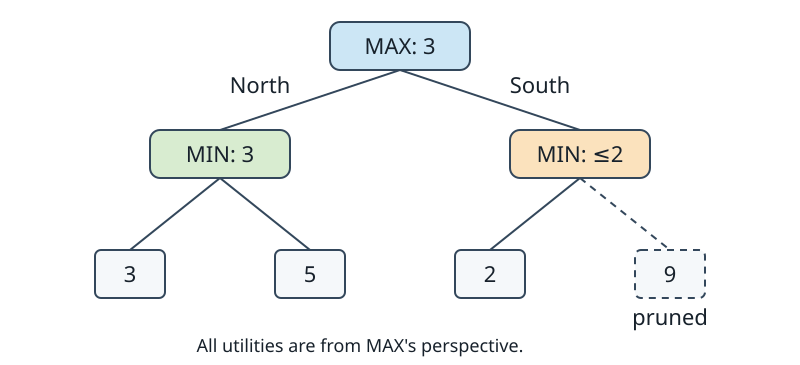

# Week 9: Adversarial Search

A pathfinder chooses actions in a world whose transitions
follow its model. A game player also faces another
decision-maker who chooses replies. A promising leaf is
not enough: the opponent may choose a different continuation.

This chapter studies deterministic, perfect-information,
two-player, zero-sum games with alternating turns.
Actions have known results, both players observe the
rule-relevant situation, and one player's gain is the
other's loss. Call the player at the root MAX and its
opponent MIN. These names stay fixed throughout the search.
All utilities are measured from MAX's perspective.

The goal is to choose a move with a strong guaranteed outcome
against an opponent who also chooses well. We first define
that outcome precisely, then explain how to obtain it with
less work and how practical depth limits change its meaning.

## States, turns, and terminal outcomes

A game state includes the side to move and every other fact
that affects future rules or outcomes. A chess board alone
omits castling rights, en-passant rights, and draw-relevant
history. States that look identical on the board can have
different legal futures.

Let A(s) be legal actions, T(s,a) the deterministic resulting
state, and U(s) the utility of a terminal state to MAX.
For a simple win/draw/loss game, use +1, 0, and −1.
Some games instead have numeric terminal scores.

Assume initially that the explored game tree is finite.
Games with cycles need explicit repetition or draw rules,
a bounded horizon, or another termination argument.
Recursing forever on repeated positions does not solve them.

A path represents one possible play sequence.
Different sequences can reach the same state, creating
**transpositions**. Their reuse is safe only when the
state includes everything needed for the rules and the
stored result answers the current search question.

Hidden information requires a different model. A public
board and unknown private cards do not give the player
one known perfect-information state. Likewise, a die roll
is a chance event rather than a strategic choice.
We return briefly to chance after deterministic games.

## Minimax

The **minimax value** uses the same utility scale at every
depth:

- At a terminal state, V(s)=U(s).
- At a MAX state, V(s) is the maximum child value.
- At a MIN state, V(s) is the minimum child value.

MAX chooses its most favorable child; MIN chooses the child
least favorable to MAX. Apply the recurrence upward from
leaves to obtain the root value. A root action attaining
that value is an optimal choice under this model.

Consider a MAX root with moves North and South.
After North, MIN chooses terminal utilities 3 or 5.
After South, MIN chooses 2 or 9.

North has value min(3,5)=3.
South has value min(2,9)=2.
MAX chooses North and guarantees value 3.

The largest leaf is 9, but it requires MIN to cooperate.
Choosing a route to that leaf treats the opponent's action
as if MAX controlled it. Minimax instead respects who makes
each choice.

The recurrence is correct by induction on remaining depth.
At leaves, the assigned utilities are the rules of the model.
If child values correctly represent optimal continuation,
taking the maximum or minimum represents the current player's
best available action. That establishes the parent value.
Applying this step to the root establishes minimax.

For maximum branching b>1 and horizon D, full-width work is
O(b^D) in the worst case. With incrementally generated
successors, the active traversal can retain O(D) records;
storing all siblings at every level gives O(bD).
Concrete state sizes and transposition tables add storage.

One **ply** is one player's move. Increasing a horizon by
one ply can multiply tree size by roughly the branching
factor. This growth motivates pruning even before considering
more complicated evaluators.

## Alpha-beta pruning

**Alpha-beta search** obtains the same minimax root value
while sometimes leaving subtrees unexplored.

Alpha, α, represents a lower bound already available to MAX
through choices along the current ancestry. Beta, β,
represents a corresponding upper bound imposed by MIN.
At a MAX node, improve the local best value and raise α.
At a MIN node, improve the local minimum and lower β.
When α≥β, further children cannot improve the relevant
ancestor's decision.

Start the root with α=−∞ and β=∞.
Search North first. Its first reply has value 3, lowering
North's β to 3. Its second reply is 5, so North remains 3.
The root can now choose an action worth 3 and raises α to 3.

Search South with inherited α=3. Its first reply is 2,
lowering β to 2. Since 2≤3, stop: MIN can hold South to
at most 2, while MAX already has North worth 3.
The utility-9 leaf need not be examined.

This is a bound argument, not a prediction that the unseen
leaf is bad. At a MIN node, finding one sufficiently low
child establishes an upper bound on the node's value:
additional children can only keep or lower that minimum.
At a MAX node, finding one sufficiently high child
establishes a lower bound by the symmetric argument.

The cutoff includes equality. If an alternative cannot
improve on a known value, it can be skipped when the task
is to find one optimal action. Enumerating all tied optimal
actions, or applying a secondary preference among them,
requires preserving more information. A value-preserving
cutoff need not preserve every tied line.

An interior-node return following a cutoff may be a bound
rather than an exact value. In the example, searching only
South's first child establishes V(South)≤2.
It does not establish equality unless its other children
are also accounted for. The root choice is nevertheless
exact because South cannot defeat North.

## Move ordering

Alpha-beta's worst-case work remains O(b^D). With ideal
ordering in a regular tree, the leaf count can be on the
order of b^(D/2). This is an idealized bound; an actual
tree's shape, move order, and horizon determine its savings.

Try good moves early to tighten bounds sooner.
A previous iteration's best move, tactical domain knowledge,
or a stored transposition move can supply an ordering hint.
The hint does not need to prove anything about the value:
a poor ordering increases work without changing the
full-width minimax result.

Permanently deleting a move because it looks unpromising
is different. Unless a sound pruning argument applies,
that deletion changes the game being searched.
Separating ordering hints from proof-bearing cutoffs is
the same discipline used for lower bounds in path search.

Ties should be resolved consistently when tracing or
benchmarking an implementation. Different tied orders can
create different cutoff patterns even while the final
root value remains identical.

## Depth limits and evaluation

Large games cannot usually be searched to terminal states.
At a chosen horizon, replace unfinished leaves with an
evaluation E(s), also from MAX's perspective.
The recurrence then computes minimax for this truncated
tree, not the actual game value.

An evaluator can combine features such as material,
mobility, threats, and positional control.
Larger scores must always favor MAX.
A fixed-perspective implementation maximizes at MAX nodes
and minimizes at MIN nodes; it does not arbitrarily negate
the evaluator on alternate calls.

Negamax is another valid convention for suitable zero-sum
games. It changes perspective and negates returned values
at turns. Mixing negamax sign rules with a fixed-MAX
evaluator produces plausible but incorrect decisions.
Choose one convention and keep terminal and heuristic
scores consistent with it.

Terminal scores need an appropriate range. If every
nonterminal estimate lies between −100 and 100, a terminal
MAX win can be assigned a larger score than 100.
Without such separation, an estimated favorable position
can outrank a known win.

A **horizon effect** occurs when a consequence falls just
beyond the boundary. A position may look favorable one ply
before an unavoidable capture. Searching deeper or extending
unstable positions can expose that consequence, but costs
more work and does not eliminate every horizon problem.

A **quiescence search** continues selected tactical
continuations instead of immediately applying a static
evaluation in an unstable position. Its move selection and
termination rules become part of the search semantics.
It is not a proof of full-game optimality.

A deeper search can also expose an evaluator's biases.
Depth alone does not guarantee stronger play if the model,
terminal handling, or evaluation is wrong.
Use small tactical examples and independently computed
trees to distinguish rule bugs from evaluation weaknesses.

## Iterative deepening under a deadline

Search successively to horizons 1, 2, 3, and so on.
Early iterations supply a completed answer and improve
move ordering for later iterations. The previous best root
move is tried first; useful continuation moves can guide
the rest of the tree.

Keep the result of the last fully completed iteration.
If a deadline interrupts the next iteration, returning a
partially updated root result can unfairly compare a fully
searched move with an unfinished competitor.
A legal fallback move should exist even before depth one
finishes.

The **principal variation** is the search's current preferred
line: MAX's choice, MIN's preferred reply, and so on.
It explains the model's forecast, not a promise that actual
play will follow that line.

This is an anytime mechanism in the practical sense of
having an answer available under interruption.
Unlike a monotonically improving optimization incumbent,
deeper heuristic minimax values need not improve monotonically.
A horizon can reveal a threat or change which evaluation
features dominate.

Record the completed horizon and search semantics with a
result. “Searched to depth eight” is ambiguous if selective
extensions or reductions make different branches reach
different effective horizons.

## Transposition tables

A **transposition table** stores information from earlier
searches of the same state. An entry can include its key,
remaining horizon, value, bound type, and suggested move.

Exact state comparison provides collision-safe identity.
A compact fingerprint instead introduces a probabilistic
tradeoff. Two hashes that happen to agree do not constitute
a mathematical proof of state equality. The representation
must also distinguish turn, rights, and relevant history.

The bound types are:

| Type | Meaning for the compatible query |
| --- | --- |
| EXACT | V equals the stored value |
| LOWER | V is at least the stored value |
| UPPER | V is at most the stored value |

A cutoff at a MAX node can establish a LOWER bound;
a cutoff at a MIN node can establish an UPPER bound.
Storing every return as EXACT can corrupt later decisions.

For a compatible query, an EXACT entry can be returned
directly. A LOWER entry can raise α; an UPPER entry can
lower β. If the tightened window closes, its bounds justify
a cutoff. Otherwise, continue searching.
Even an entry whose value cannot be reused can supply
a move-ordering hint.

Compatibility includes the horizon and evaluation rules.
A depth-eight heuristic minimax value need not equal the
depth-three value at the same state. To preserve an exact
fixed-horizon specification, reuse values for a matching
horizon and compatible semantics, or use a genuinely solved
game value whose meaning is horizon-independent.

Practical engines sometimes deliberately reuse deeper
results for shallower requests. That may be useful, but it
changes the exact fixed-horizon function being computed.
Do not justify it merely by saying “deeper is more accurate.”
Selective extensions, repetition rules, evaluation changes,
and root-relative mate-distance scores need compatible
treatment too.

Retain the call's original α and β when classifying
a completed result. A fail-low result at or below original
α is an upper bound; a fail-high result at or above
original β is a lower bound. A result strictly inside
the original window is exact when the search and all
reused bounds are compatible.
The current, repeatedly modified window alone is not
a sufficient record of the query.

## Chance nodes

A random event is not a MIN move. At a chance node with
outcome probabilities p_i and continuation values v_i,
use the expectation Σ p_i v_i, with probabilities summing
to one. MAX and MIN still optimize at their own decision
nodes. This extension is often called expectiminimax.

For a fair two-outcome event with values 2 and 8,
the expectation is 5, rather than the minimum 2 or
maximum 8. The probability model and utility scale determine
what that average means.

Ordinary alpha-beta cutoffs do not transfer unchanged:
a partially accumulated expectation can increase or decrease
when unseen outcomes are included. Safe pruning needs bounds
on their values and probabilities or another justified rule.

Hidden cards introduce a further issue: future choices
depend on what each player knows. Treating private
information as a fully observed chance outcome can give
a player information it should not possess.
That topic lies beyond this perfect-information introduction.

The next chapter explores sampling as another way to
allocate game-search effort. The fixed utility convention,
state identity, and distinction between estimates and
proofs remain important there.

## Further reading

- Shannon, [“Programming a Computer for Playing
  Chess”](https://doi.org/10.1080/14786445008521796) (1950).
  A foundational account of the partnership between search
  and static evaluation.
- Knuth and Moore,
  [“An Analysis of Alpha-Beta Pruning”](https://doi.org/10.1016/0004-3702(75)90019-3)
  (1975). Explains alpha-beta's behavior and why move
  ordering can change its cost so substantially.
